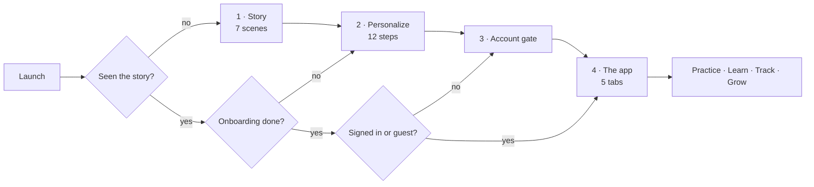
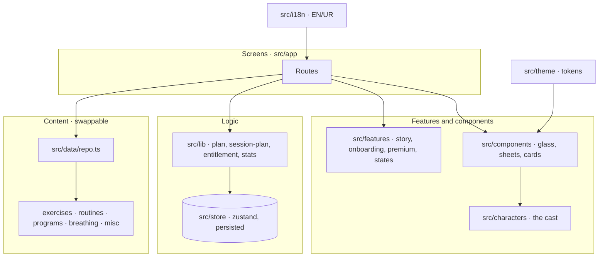

<div align="center">

# 🌿 Kaizen Yoga

**Small steps. Calmer days.**

A calm, beginner‑friendly yoga companion for people who sit too long, sleep too little and think they "aren't flexible enough".
Three‑minute sessions, easy versions of every pose, and a gentle 30‑day path, in **English** and **اردو (right‑to‑left)**.


-2E7D5B)


</div>

---

## Contents

1. [What the app is](#1-what-the-app-is)
2. [Take the tour: follow a first‑time user](#2-take-the-tour-follow-a-first-time-user)
3. [Core functionality](#3-core-functionality)
4. [The people you meet](#4-the-people-you-meet)
5. [Screen map: app ⇄ code](#5-screen-map-app--code)
6. [How it is built](#6-how-it-is-built)
7. [Run it](#7-run-it)
8. [Quality gates](#8-quality-gates)
9. [Status, limitations and roadmap](#9-status-limitations-and-roadmap)
10. [Docs index](#10-docs-index)

---

## 1. What the app is

Most yoga apps assume you are already flexible, already motivated and already have 45 minutes. Kaizen Yoga assumes the opposite.

| Principle | What it means in the app |
|---|---|
| **Kaizen: tiny, steady improvement** | Sessions start at **3 minutes**. A 30‑day path grows from breathing, to gentle stretches, to a rhythm you can keep. |
| **No pressure** | Every pose has an easier version, a "Something hurts" button, and rest days are part of the plan. |
| **Safety first** | Mandatory age and safety steps, pose cautions, and a support page with helplines. Safety information is **never** behind a paywall. |
| **Warm, never clinical** | The app never diagnoses, treats or promises results. A copy audit enforces this (see [Quality gates](#8-quality-gates)). |
| **For everyone** | English and Urdu (full RTL), three text sizes, Night mode, Reduce Motion, Reduce Transparency, and chair‑friendly options. |

> **Who is it for?** Four everyday people stand in for the audience: someone with back‑to‑back days, someone new and nervous, someone stiff from a desk, someone who cannot switch off at night. You meet them in the first minute. See [The people you meet](#4-the-people-you-meet).

---

## 2. Take the tour: follow a first‑time user

Open the app on a fresh install and you walk this exact path. The router decides where you land at every launch ([`src/app/index.tsx`](src/app/index.tsx)), so you can resume mid‑funnel and never see a dead end.



### Step 1: The story (7 scenes, about a minute)

An illustrated, swipeable intro ([`src/app/(story)`](src/app/(story)), [`src/features/story`](src/features/story)). Swipe, tap *Next*, use the pulsing arrow on the screen edge (forward on the first scene, both ways in the middle, back on the last), or *Skip* at any time; the Android back button steps back one scene. A "Step n of 7" line at the bottom shows where you are.

| # | Scene | What it tells you |
|---|---|---|
| 1 | **Welcome** | Kai, the leaf‑sprout guide, says hello. *Begin* or *I already have an account*. |
| 2 | **Sound familiar?** | Three people voice the problems the app exists for: stiff back, stuck neck, can't switch off. |
| 3 | **You're not alone** | They realise they all feel the same. Stress and stiffness are common. |
| 4 | **Meet Arif** | Someone who started where you are arrives and explains the 3‑minute idea. |
| 5 | **Four ways in** | Pick the person who sounds most like you and see their before/after, what they started with, and what they would tell you. |
| 6 | **Your 30‑day path** | The shape of the journey: *Learn to breathe → Find your rhythm → Make it yours*. |
| 7 | **What brings you here?** | Choose your goals (stress, back/neck, sleep, focus, flexibility, balance). This is also step 1 of personalization. |

### Step 2: Personalize (12 steps, about a minute)

One question per screen, always skippable **except the two that protect you** ([`src/features/onboarding/steps.ts`](src/features/onboarding/steps.ts)).

`Goals → Experience → Time per day → Schedule → Movement preferences → Equipment → Accessibility needs → Voice & music → Age 🔒 → Safety 🔒 → Reminders → Your plan`

Two screens do more than ask. **"When would you like to practice?"** changes its background to match your answer (green morning, blue afternoon, lavender evening). **"How would you like to be guided?"** plays real sound: tap a voice to hear a sample, switch on the music, or pick rain, forest or soft piano, and they mix. Sound stops when you leave the screen.

🔒 = required. Under‑18s are redirected to a dedicated screen. The last step reveals **your plan**: focus areas, daily minutes, best time, practice days, your first session, and "someone with a goal like yours" with what they started with.

### Step 3: Account gate

Create an account, sign in, recover a password, or **continue as a guest** ([`src/app/(auth)`](src/app/(auth)/)). Auth is a mock today (see [limitations](#9-status-limitations-and-roadmap)).

### Step 4: The app: five tabs

| Tab | Purpose |
|---|---|
| 🏠 **Home** | A greeting and quick mood check‑in, a **recommended** session for you, **quick relief**, *resume* where you stopped, and your favourites. |
| 🧭 **Explore** | The library: routines, poses, programs, collections, styles. Search with filters. |
| ▶️ **Practice** | The centre button opens a quick sheet instead of a screen: **today's session**, **breathing**, **quick relief**, or **resume** where you left off. |
| 📈 **Progress** | Your journey, calendar, mood insights, reflections, achievements and session history. |
| 👤 **Profile** | Your companion, goals, reminders, accessibility, subscription, privacy, help. |

---

## 3. Core functionality

### 🧘 Practice

| Feature | Detail |
|---|---|
| **Pose library** | **66 poses**, each with steps, an easier and a harder version, cautions and a "good for" list. Filter by category, level, position (standing, seated, floor, chair) and equipment. |
| **Routines** | **27 routines** from a 3‑minute desk reset to evening wind‑downs. Build and edit your own **custom routines**. |
| **Programs** | **8 programs**, including the **30‑day Kaizen Path**, Yoga for Beginners, Deep Relaxation, Better Sleep and Core Strength. Day‑by‑day, rest days built in. |
| **Breathing** | **7 guided breathing sessions** with an animated breathing circle and gentle haptics. Always free. |
| **Session setup** | Choose duration, focus, pace, a **chair‑friendly** option, voice and music before you start. |
| **Session player** | Timer with **pause, skip, swap a pose for an easier one**, and **"Something hurts"** which pauses the clock, offers a modification or a rest, and never pushes you on. Leave early and **resume later** from where you stopped. |
| **Completion** | A gentle finish with a before/after mood check, and any achievement you just earned. |

### 🛡️ Safety (a feature, not a footer)

- Required **age** and **safety** steps in onboarding; **under‑18** path.
- Pose‑level cautions, a global safety notice, and a **"not medical advice"** stance in every disclaimer.
- A **Support resources** page with crisis and helpline entries, reachable from Profile and the safety screens.
- **Never paywalled:** safety information, breathing, the starter session and quick‑relief routines.

### 📈 Progress

Journey path, practice **calendar**, **mood insights** (a chart of how you felt before and after), **reflection** prompts, **achievements**, and a per‑session **history** with detail. Rest days are shown as part of the plan, not as failure.

### 🌱 Personalization

Your goals, experience, time, schedule, movement and equipment choices shape the suggested plan and the "Today" card. Everything is editable later in **Profile → Goals / Preferences**.

### ♿ Accessibility and language

| Setting | Options |
|---|---|
| **Language** | English, **اردو** with full RTL mirroring. Every string exists in both (typed key parity). |
| **Text size** | 100 %, 115 %, **130 %**; layouts are tested at 130 %. |
| **Appearance** | Light, **Night**, or follow the system. |
| **Reduce Motion** | Replaces slides and loops with simple fades; characters stop idling. |
| **Reduce Transparency** | The glass surfaces switch to solid fills. |
| **Haptics / voice / music** | Individually adjustable. |
| **Screen readers** | Labels on every control, headings, radio groups and live state. |

### 💎 Premium (mock)

A free tier that is genuinely useful, plus **Premium** for programs, sleep content, offline downloads, insights, extra voices and custom routines. The paywall, mock checkout (success, failure, cancelled), **manage subscription** (free, trial, active, cancelled, expired), and a **"help with affording it"** request are all built. Gating lives in one place: [`src/lib/entitlement.ts`](src/lib/entitlement.ts) (`useEntitlement` / `gate`).

### 🫧 Calm states

Skeleton loaders, empty states, an offline banner, full‑screen and inline errors, and a reusable *Coming soon* screen. All speak in Kai's gentle voice.

---

## 4. The people you meet

The app's stories are told by four people and one guide. Their look and story are defined in [`docs/character-bible.md`](docs/character-bible.md); the portraits live in [`assets/images/people`](assets/images/people): a worried "before" and a happy "after" image for each person, used side by side in *Four ways in* and for happy avatars.

| | Who | Their story | Colour |
|---|---|---|---|
| 🟣 | **Hina** | Back‑to‑back days at the office; a stuck neck by 3 pm. Starts with a 3‑minute desk reset. | Lilac |
| 🟢 | **Arif** | The one who has been there: scared to start, found a 3‑minute version with no pressure. The app's guide‑in‑the‑story. | Teal |
| 🟡 | **Hamid** | Ten hours at a desk; a stiff back. Starts with a desk‑neck reset. | Mustard |
| 🟠 | **Sarah** | Evenings spent scrolling; restless nights. Starts with an evening wind‑down. | Coral |
| 🌱 | **Kai** | The leaf‑sprout companion who reacts to your mood, celebrates your sessions and appears in every empty or error state. | Sage |

They return across the app: the *Practice with…* suggestions on routine and program pages, your profile companion, the plan reveal, and reflections. They are illustrated characters, **not real people**.

---

## 5. Screen map: app ⇄ code

Find a screen you saw, or a file you are reading. Routes use [Expo Router](https://docs.expo.dev/router/introduction) file‑based routing under [`src/app`](src/app).

| Area | What you see | Route file(s) |
|---|---|---|
| **Story** | 7 intro scenes | `(story)/story.tsx`, scenes in `src/features/story/scenes/` |
| **Personalize** | Goals → plan reveal | `(onboarding)/goals · experience · time · schedule · movement · equipment · accessibility · voice · age · under-18 · safety · reminders · plan` |
| **Account** | Gate, sign up, sign in, reset | `(auth)/gate · sign-up · sign-in · forgot-password · verify-code · reset-password` |
| **Tabs** | Home, Explore, Practice, Progress, Profile | `(tabs)/home · explore · practice · progress · profile` |
| **Library** | Search, categories, collections, styles, programs | `search`, `library/styles · programs`, `library/category/[id] · collection/[id] · style/[id]` |
| **Detail** | Pose, routine, custom routine, program | `pose/[id]`, `routine/[id]`, `routine/custom/[id]`, `program/[id]` |
| **Session** | Setup, player, completion | `session/setup · player · complete` |
| **Breathing** | Hub and guided player | `breathing/index`, `breathing/[id]` |
| **Journey** | Calendar, mood, reflection, achievements, history | `journey/calendar · mood · reflection · achievements · history · session/[id]` |
| **Premium** | Paywall, success, affordability | `premium/index · success · help-affording` |
| **Settings** | 13 settings screens | `settings/preferences · goals · reminders · accessibility · health · downloads · subscription · privacy · terms · safety · help · contact · about` |
| **Support** | Helplines and resources | `support/resources` |
| **Favorites** | Saved poses and routines | `favorites` |
| **Dev only** | Screen showcase, component and character galleries | `dev/screens · ui-kit · characters · icons · states` (hidden in production builds) |

---

## 6. How it is built

### Stack

| Layer | Choice |
|---|---|
| Framework | **Expo SDK 57**, React Native, TypeScript, **Expo Router** (typed routes, `Stack.Protected` guards for the funnel) |
| Styling | **NativeWind 4** (Tailwind) driven by generated design tokens |
| Motion | **Reanimated 4**, Worklets, Moti |
| Graphics | `react-native-svg` (characters, props, covers, icons) and Phosphor icons |
| State | **Zustand** stores, persisted on device |
| i18n | **i18next**, EN + UR with RTL, typed key parity |
| Native bits | `expo-blur`, `expo-haptics`, `expo-network`, `expo-clipboard`, `expo-linear-gradient` |

### Architecture at a glance



**Key ideas**

- **One door for content.** Screens read content only through [`src/data/repo.ts`](src/data/repo.ts). Today it returns local data synchronously; a backend can replace the bodies with async fetches without changing any screen.
- **Mock layers are isolated.** Auth, subscription, content and sync are stores or repo functions, so the planned backend work *replaces a mock, not a screen*.
- **Design tokens, not magic numbers.** Colours, type, spacing, radius and shadow live in [`src/theme`](src/theme). `npm run theme:sync` generates the Tailwind and CSS variables. **No raw hex colours outside `src/theme`.**
- **Glass design system.** `GlassCard` and `AuroraBackground` give the frosted look, with solid fallbacks for Reduce Transparency and Android, where blur is currently off.
- **The cast is data.** Characters are plain data (`src/characters/art`) rendered by `react-native-svg`, with a shared face and mood system. The story and avatars use rendered portraits for the four people (see [`src/components/person-photo.tsx`](src/components/person-photo.tsx)).
- **Copy lives in i18n.** Editing a sentence never touches layout code; story timing and who appears are in [`src/data/story.ts`](src/data/story.ts).

### Folder map

```
src/
├─ app/           Routes (Expo Router): story, onboarding, auth, tabs, session, settings…
├─ components/    Reusable UI: glass cards, sheets, cards, mood picker, breathing circle…
│  └─ ui/         Primitives: Button, Text, Chip, Icon, Progress, Skeleton…
├─ features/      Feature code: story, onboarding, premium, progress, states…
├─ characters/    Kai + the people: art data, SVG engine, props, scene settings, portraits
├─ data/          Mock content + repo.ts (the single content entry point) + validation
├─ lib/           Pure logic: plan, session-plan, entitlement, stats, journey, routines…
├─ store/         Zustand stores: app, auth, prefs, progress, session, subscription, library
├─ theme/         Design tokens, motion, story palette, illustration colours
├─ i18n/          en.ts, ur.ts, direction helpers
└─ hooks/         Reduced motion, reduced transparency, screen loading
assets/           Brand (logo SVG/PNG), icons, fonts, images (people portraits), audio loops
docs/             Plan, UI build spec, character bible, content audit
scripts/          validate-data, sync-theme, audit-copy
```

---

## 7. Run it

**Requirements:** Node 20+, npm, and (for a device build) Android Studio's SDK.

```bash
npm install
npx expo start            # then press  a (Android)  ·  i (iOS)  ·  w (web)
npm run web               # quickest way to look around in a browser
```

A fresh install starts at the story. To look at components without clicking through the funnel, in development builds open the **dev galleries** (`/dev/ui-kit`, `/dev/characters`, `/dev/states`, `/dev/icons`) for the components, the cast in every pose and mood, and all calm states.

### Build an Android APK locally

Bump `version` (1.1.0 → 1.2.0 …) and `android.versionCode` in `app.json`, then run `npm run apk`. The APK is named after the version. Or by hand:

```bash
cd android
ANDROID_HOME=$HOME/Android ./gradlew assembleRelease -PreactNativeArchitectures=arm64-v8a
# → android/app/build/outputs/apk/release/app-release.apk
```

Install it with `adb install --user 0 -r app-release.apk`. The `arm64-v8a` build targets real phones; for an x86 emulator drop the architecture flag.

### Scripts

| Command | What it does |
|---|---|
| `npm start` · `npm run android` · `npm run ios` · `npm run web` | Start the dev server or open a platform |
| `npm run typecheck` | `tsc --noEmit` |
| `npm test` | Automated tests (Node's test runner via tsx): the recommendation engine's safety rules, content data rules, session plan, reminder timing and the data export |
| `npm run audit:i18n` | Finds English text typed straight into screens instead of going through translation |
| `node scripts/qa-sweep.js 320 light no en` | Opens every screen at a phone width (and theme, large text, language) and reports errors and sideways overflow (needs the web preview running) |
| `npm run lint` | ESLint via Expo |
| `npm run validate:data` | Checks that content references (poses in routines, ids, levels) are consistent |
| `npm run audit:copy` | Scans English copy for banned medical or absolute claims |
| `python3 scripts/make-sounds.py` | Regenerates the original sound loops in `assets/audio` (rain, forest, soft piano, music). Replace with recorded audio before release. |
| `scripts/make-brand.py` | Rebuilds the logo as vector + transparent PNGs from `assets/brand/source/` and regenerates the app icon, adaptive icon, splash and favicon (needs `potracer`, `pillow`, `numpy` in a venv). |
| `npm run apk` | Builds the release APK as `dist-apk/KaizenYoga-<version>.apk`. Bump `version` (minor) and `android.versionCode` in `app.json` first. |
| `npm run theme:sync` | Regenerates Tailwind tokens and `global.css` from `src/theme` |

---

## 8. Quality gates

Every change should pass these before it is called done:

- ✅ `npm run typecheck`, `npm run lint`, `npm test`
- ✅ `npm run validate:data`
- ✅ `npm run audit:copy`: **0 wording issues** (no *cure, treat, diagnose, heal, guarantee, "proven to"…* in user‑facing copy)
- ✅ EN ⇄ UR **key parity** (typed)
- ✅ No raw hex colours outside `src/theme`
- ✅ Checked in **Light and Night**, **Urdu RTL**, and **130 % text**, at narrow, normal and wide phone widths

---

## 9. Status, limitations and roadmap

**Where it stands:** a complete, navigable **UI prototype** running on local mock data. Every screen in the funnel exists and is reachable, and it has been run on a real Android phone.

| Area | Today |
|---|---|
| Accounts | Mocked: sign up, sign in, password recovery and guest mode work locally; no server. |
| Content | 66 poses, 27 routines, 8 programs, 10 yoga styles and 7 breathing sessions are local data. |
| Subscriptions | Mock checkout and entitlement; no real payments. Prices are placeholders. |
| Reminders | Real weekly notifications are scheduled from your days, time and quiet hours (needs a device to verify). |
| Audio, downloads | The phone's own voice and placeholder sound loops; offline files are not wired yet. |
| Premium gating | Enforced for premium content and downloads; some feature gates are still partial. |
| Recommendations | A real rule-based engine uses your goals, level, time, movement, equipment and limitations (chair-only, avoid the floor, sensitive knees or wrists, balance). |
| Privacy | "Export my data" saves a real JSON file; "Delete my data" wipes every store and cancels reminders. |

**Known gaps to close before release**

- Helpline numbers, reviewer names and **Terms / Privacy** text are placeholders and need real, verified content per country.
- The **Urdu** translations need a native review.
- **Android blur** falls back to solid fills (needs `BlurTargetView`).
- The launcher icon is still the Expo default; there is no `google-services.json` for push yet.
- A few Expo packages are patch releases behind (`npx expo install --check`).
- The root `LICENSE` is the Expo template's MIT text. Replace it with your own before publishing.
- Native‑only checks (TalkBack/VoiceOver, 60 fps on low‑end Android, iOS Reduce Transparency) need a device pass.

**Roadmap: Phase 2 (functionality)** replaces mocks with real services: backend and real auth, a content API, user‑data sync, a hardened session engine, audio, reminders, subscriptions, offline mode, health sync, privacy compliance, localization, automated tests and release. Details and decisions needed (backend provider, store accounts, voice approach) are in [`docs/PLAN.md`](docs/PLAN.md).

---

## 10. Docs index

| Doc | Read it for |
|---|---|
| [`docs/PLAN.md`](docs/PLAN.md) | Delivery plan, block order, backlog and Phase 2 decisions |
| [`docs/ui-screens.md`](docs/ui-screens.md) | The 14-screen static UI brief mapped onto the app, with decisions |
| [`docs/UI_Build.md`](docs/UI_Build.md) | The design system and screen‑by‑screen UI specification |
| [`docs/character-bible.md`](docs/character-bible.md) | The four people and Kai: stories, visual spec, where each appears |
| [`docs/content-audit.md`](docs/content-audit.md) | The copy rules and the banned‑claims scan |

---

<div align="center">

**Kaizen Yoga offers gentle movement and breathing for general wellbeing. It is not medical advice, and it does not diagnose, treat or cure anything.**
If something hurts, stop. If you are struggling, please reach out to someone you trust or to the helplines in the app.

*Built with care, one small step at a time. 🌿*

</div>
