# Onboarding audit

Captured 2026-10-16 from the running app (web build, 390×844, Light mode). Screenshots are in [`docs/onboarding-audit/`](onboarding-audit/). Every claim about what an answer is used for was checked in the code.

## 1. How many screens

| | Count |
|---|---|
| **Story scenes** (swipeable intro, "Step n of 7") | **7** |
| **Personalization screens** after the story (progress bar) | **11** |
| **Total on the normal path** | **18** |
| Conditional: **Under‑18** exit screen (only if the user says they are under 18) | +1 |
| After onboarding: **Account gate** ("Save your journey"), then sign up / sign in | not counted |

Note: scene 7 ("What brings you here?") is also personalization step 1 (goals), so it is counted once, in the story.

**Rules in the flow today:** *Skip* is on every story scene and on most questions. **Age** and **Safety** cannot be skipped. *Continue* stays disabled until you answer on goals, experience, schedule, movement, equipment and safety.

## 2. Every screen

### Story (7)

| # | Title shown | What it does | Screenshot |
|---|---|---|---|
| 1 | **Small steps. Calmer days.** (Welcome) | Kai greets you. *Begin* or *I already have an account*. | 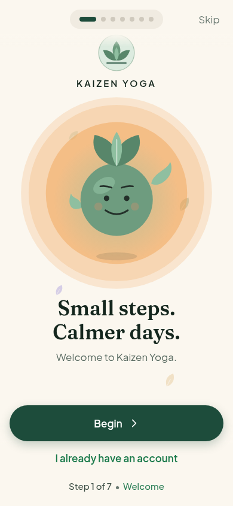 |
| 2 | **Sound familiar?** | Hamid, Hina and Sarah each voice a problem (desk back, packed days, can't switch off). | 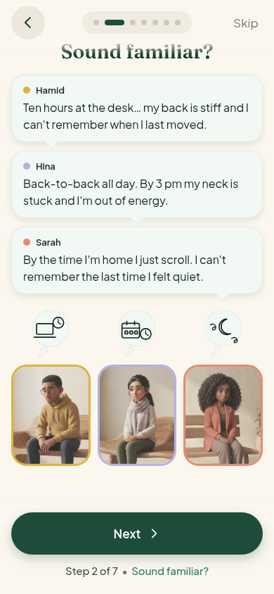 |
| 3 | **You're not alone** | The same three realise they feel the same. A caption and a "Yes, me too" tap. | 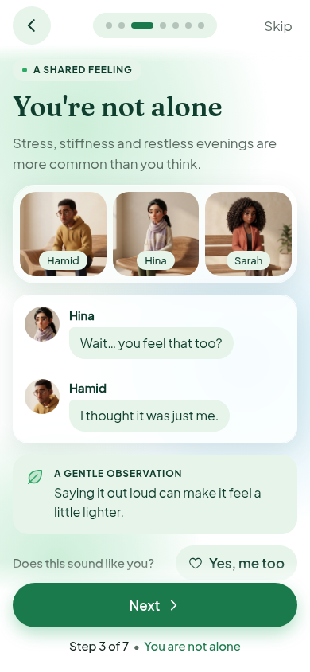 |
| 4 | *(no title)* "Meet Arif" | Arif arrives and says he felt the same and found a 3‑minute session. | 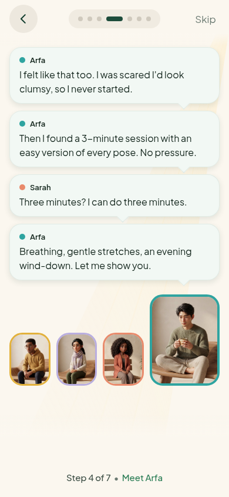 |
| 5 | **Four ways in** | Pick one of the four people; see their before/after, what they started with, what they'd tell you. | 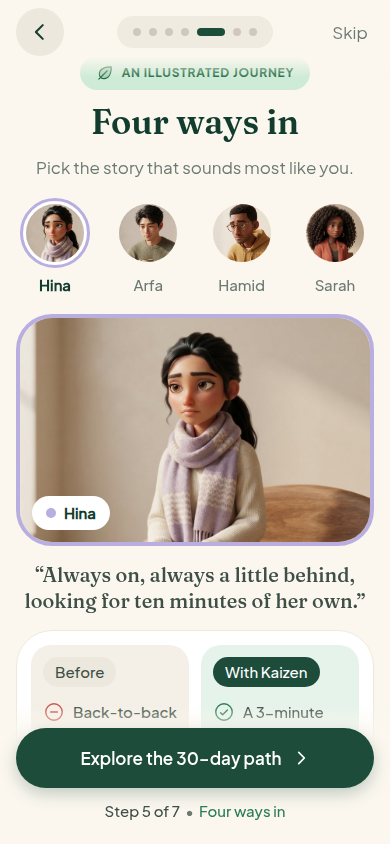 |
| 6 | **Your 30‑Day Kaizen Path** | A generic four‑week timeline. | 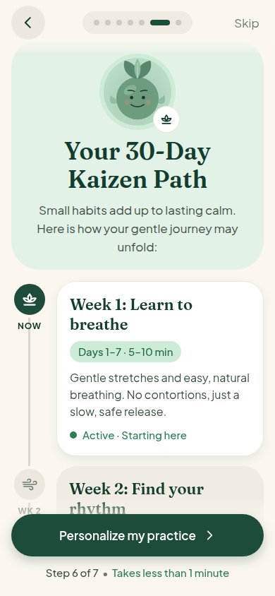 |
| 7 | **What brings you here?** | Choose your goals (multi‑select). Also personalization step 1. | 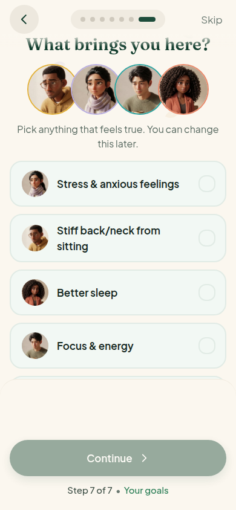 |

### Personalization (11, including the plan reveal)

| # | Title shown | Asks | Required? | Screenshot |
|---|---|---|---|---|
| 8 | **How much yoga have you done?** | Beginner / Some / Experienced | Skippable | 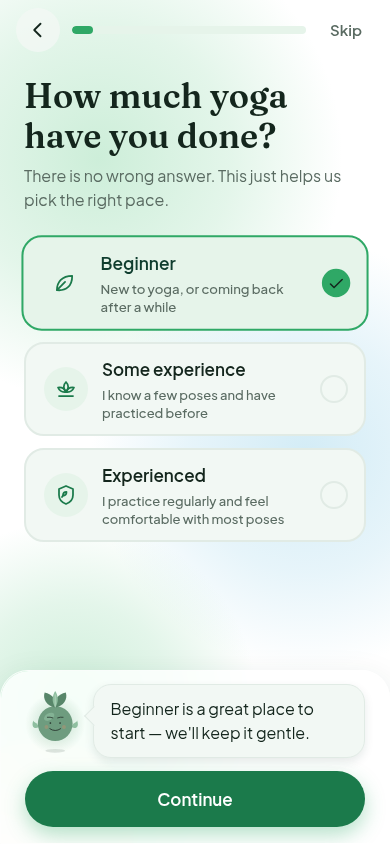 |
| 9 | **How much time feels right each day?** | 5 / 10 / 15 / 20 min | Skippable | 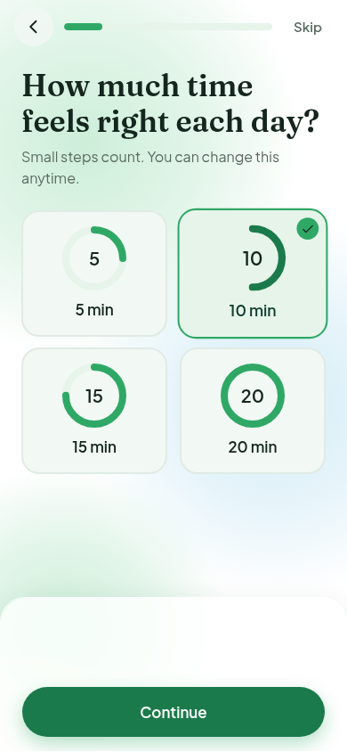 |
| 10 | **When would you like to practice?** | Time of day + practice days | Skippable | 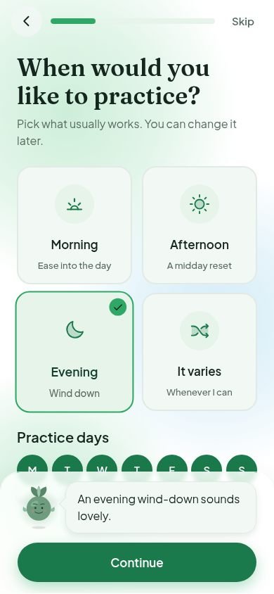 |
| 11 | **How do you like to move?** | Seated / Standing / Floor / Low‑impact / Mixed | Skippable | 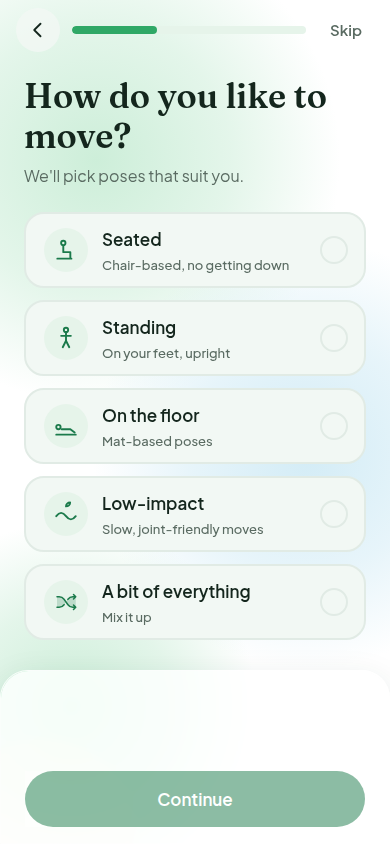 |
| 12 | **What do you have at home?** | Mat, chair, blocks, strap, cushion, none | Skippable | 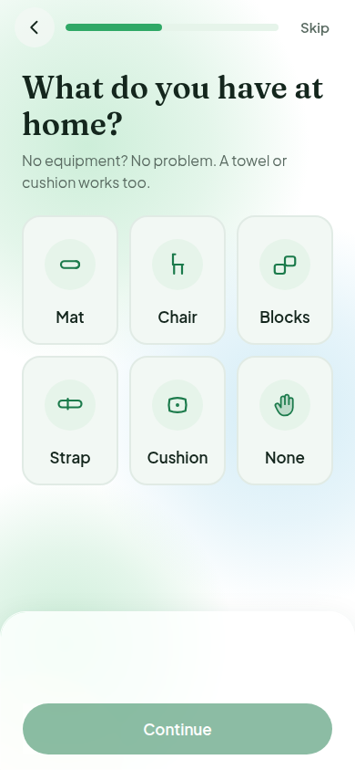 |
| 13 | **Anything we should be gentle with?** | Balance, knees, wrists, chair‑based, avoid floor transitions | Skippable | 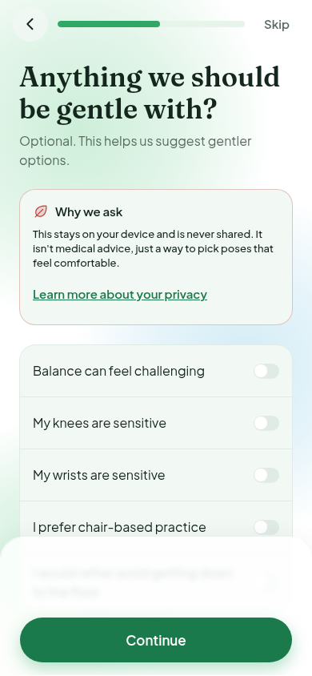 |
| 14 | **How would you like to be guided?** | Voice, music, ambience | Skippable | 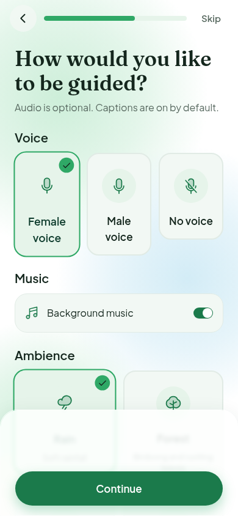 |
| 15 | **A quick check** | "Designed for adults 18+" | **Required** | 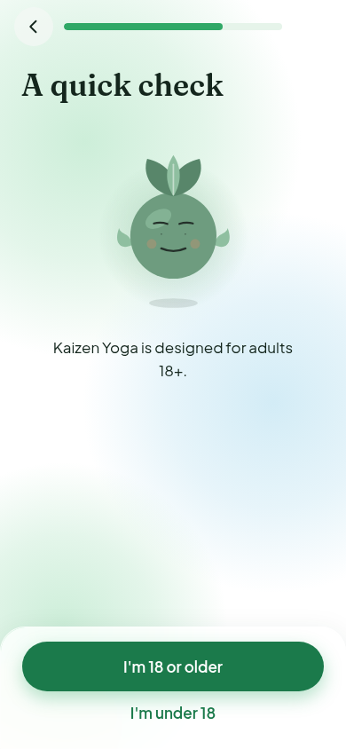 |
| 16 | **Before we begin** | Safety notice + "I understand" | **Required** | 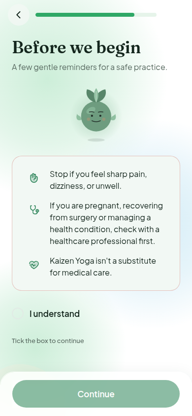 |
| 17 | **Want a gentle nudge at your chosen time?** | Reminder time, quiet hours | Skippable ("Not now") | 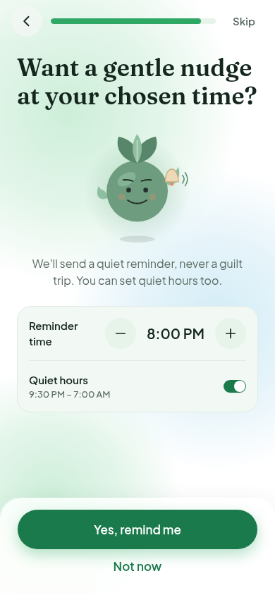 |
| 18 | **Your 30‑day Kaizen journey** (Plan reveal) | Summary + first session; *Start my first session* or *Explore first* | n/a | 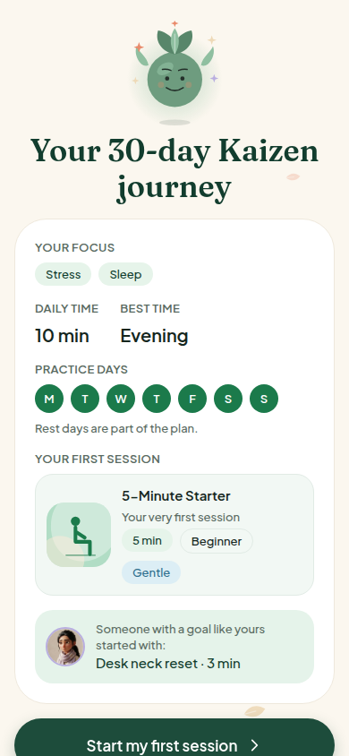 |

### Outside the 18

| Title | Screenshot |
|---|---|
| **Thanks for being honest** (Under‑18, conditional) | 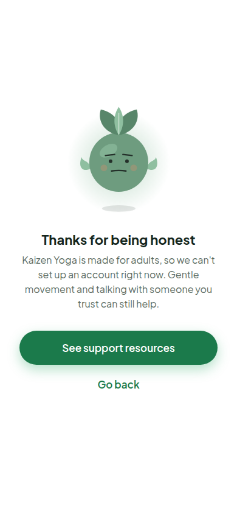 |
| **Save your journey** (Account gate, after the plan) | 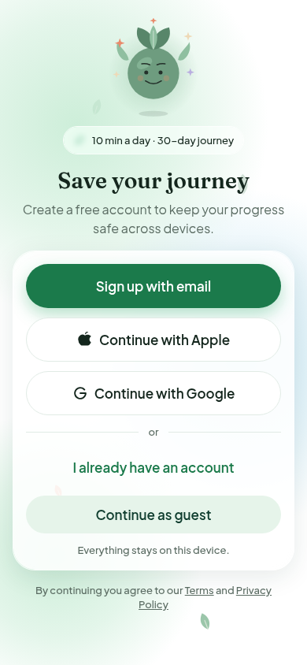 |

## 3. What the app does with each answer today

This is the key finding. Only some answers change anything.

| Answer | Used by the app today? | Where |
|---|---|---|
| Goals | **Yes** | Picks which person's story appears in the plan reveal and companion picks |
| Time per day | **Yes** | Plan reveal, profile, settings |
| Preferred time + practice days | **Yes** | Plan reveal, Home week strip, calendar, reminder suggestion |
| Voice / music / ambience | **Yes, but asked again** | Session setup and Settings → Preferences already ask the same three things |
| Reminders | **Yes** | Settings → Reminders |
| **Experience** | **No** | Stored, only editable in Settings. No recommendation reads it. |
| **Movement preference** | **No** | Stored only. |
| **Equipment** | **No** | Stored only. Equipment is used as an Explore filter and on routine pages, not from this answer. |
| **Accessibility / limitations** | **No** | Stored only. The session setup has its own **chair mode** toggle. |

The plan generator is a mock that always suggests the 5‑minute starter, so four of the questions currently collect data that nothing uses. The real plan engine (Phase 2, FN‑09) will use them, but today the user answers four screens for no visible effect.

## 4. Recommendations: what is redundant

The 18‑screen length also breaks a promise on screen: scene 6's footer says **"Takes less than 1 minute"** for a flow that is 11 more screens.

> **Spec note:** `docs/UI_Build.md` lists all of these screens. Anything below that removes or merges one is a change to the spec, so it needs your approval before I touch it.

### A. Remove: clear duplicates (no loss)

| Screen | Why it is redundant | What to do |
|---|---|---|
| **14 · Voice & music** | The same three choices appear again in **Session setup** and **Settings → Preferences**. No real voice packs exist yet, so the choice does nothing today. | Remove. Use the defaults and ask at the first session setup. |
| **12 · Equipment** | Answer is unused. Equipment is already a filter in Explore and listed on each routine. "Chair" also repeats screens 11 and 13. | Remove. Keep Equipment in Explore filters and Session setup. |
| **6 · 30‑Day Kaizen Path** | The path is promised twice: this generic timeline, then the personalised "Your 30‑day Kaizen journey" in the plan reveal. | Remove from the story (the component stays; Progress reuses it). |
| **3 · You're not alone** | Same three people, same problem as scene 2; it adds one reaction and a caption. | Fold the two lines "Wait… you feel that too?" / "I thought it was just me." into the end of scene 2. |

### B. Merge: same job, one screen

| Merge | Into | Why |
|---|---|---|
| **9 Time + 10 Schedule** | **"Your rhythm"**: minutes, time of day, days | Both answer "how often and when". Time is just four tiles. |
| **15 Age + 16 Safety** | **"Before we begin"** | Two mandatory gates back to back. One screen: "I'm 18 or older" + "I understand". The under‑18 exit stays. |
| **4 Meet Arif → 5 Four ways in** | Single social‑proof screen | Arif's story appears in both. Put his three lines inside her card. |
| **11 Movement + 13 Accessibility** | **"How do you like to move?"** with an optional "be gentle with" row | "Seated/chair" and "floor" appear in both; the app does not use either yet. |

### C. Keep

Welcome · Four ways in · What brings you here? (goals) · Experience · Reminders · Plan reveal · Under‑18 (conditional) · Account gate.

*Reminders:* worth keeping, but I'd move the permission ask to **after the first completed session**, when the user has seen the value.

### Result

| | Today | After A | After A + B |
|---|---|---|---|
| Screens on the normal path | 18 | **14** | **10** |

The 10‑screen path: **Welcome → Sound familiar? (incl. "not alone") → Four ways in (incl. Arif) → Goals → Experience → Your rhythm → How do you like to move? → Before we begin → Reminders → Plan reveal.**

## 5. Other problems found while checking

1. **Two looks in one flow.** The story scenes use the cream "story palette"; scene 3 (just redesigned), the questions and the gate use the `UI_Build.md` white/aurora tokens; the plan reveal is cream again. In Light mode the funnel flips between palettes. Recommendation: migrate the remaining story scenes and the plan reveal to the spec tokens.
2. **Two progress systems.** The story now shows "Step n of 7" text with edge arrows (the dots were removed), the questions use a progress bar, and the plan has no indicator. One consistent indicator would help.
3. **"Takes less than 1 minute"** (scene 6) is no longer true at 11 questions. Update it or shorten the flow.
4. **Scene 4 has no headline.** Every other scene has one; this one is bubbles only.

## 6. Suggested order of work

1. You decide which of A and B to accept (or tell me per screen).
2. I make the cuts and merges, update the step counter and progress bar, and keep saved preferences compatible.
3. I move the remaining story scenes and the plan reveal onto the `UI_Build.md` tokens so the whole funnel looks like one app.
4. Re‑capture these screenshots and re‑run Light, Night, Urdu RTL, 130% text.
