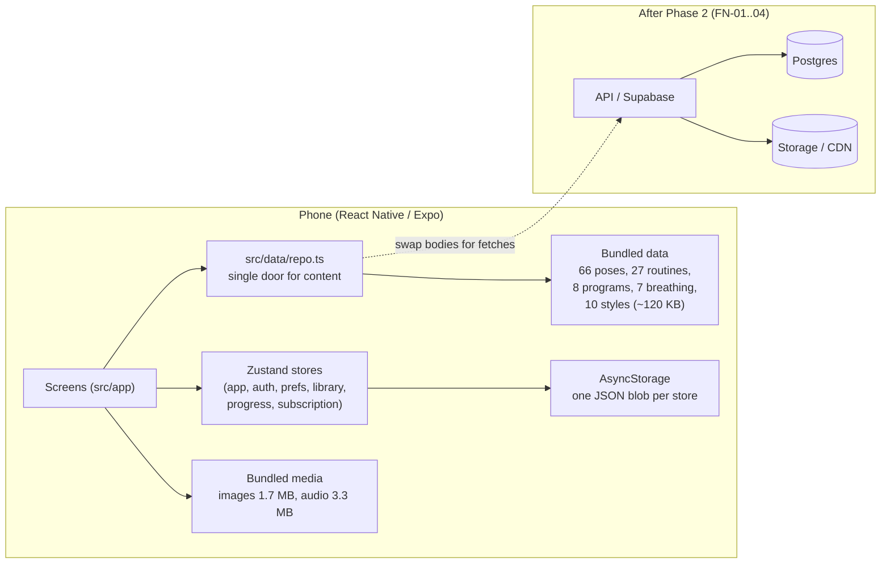

# Performance and scale readiness report (Phase 1: analysis only)

Date: 2026-10-18. Card: PERF-01. **Read-only:** no packages installed, no app code changed, no service touched. Everything below is from reading the repository. Items marked *measure* need a real phone or a staging backend and are carded (PERF-04, PERF-10).

## 1. Read this first

**The app has no backend yet.** There is no network code, no database, no Redis, no CDN. Everything is bundled in the app or stored on the phone. Three of the four areas in the brief therefore cannot be tested or tuned today, and the honest answer for them is **"not applicable yet, plan for it"**. The work that is worth doing now is on the device.

| Area | Verdict today | When it becomes real |
|---|---|---|
| **Pagination** | **Not needed** for any bundled list. **Later** for session history and mood logs. | When FN-03/FN-04 move user data to a server (PERF-05) |
| **Caching** | **Needed now, on the device** (storage engine, images). Query caching is **Later**. | PERF-03 now; PERF-06 after the backend |
| **Database indexing** | **Not applicable**: no database | After FN-01 (PERF-07) |
| **Redis** | **Not applicable**, and probably not wanted even later (see 4.3) | Decide after the backend choice (PERF-08) |
| **Load testing** | **Not applicable**: nothing to load | After a staging backend (PERF-10) |

**Launch blockers from this review: none.** The app is small and fast by construction. The two things to fix before it grows are listed in section 3.

## 2. Architecture (what exists)

- **Backend:** none. **Database:** none (AsyncStorage on the device only). **Hosting:** none.
- **Data layer:** every screen reads content through `src/data/repo.ts` (synchronous today). A backend replaces the function bodies, not the screens.
- **Content source:** bundled. Pose pictures are placeholder shapes; the four people portraits (about 700 KB) and audio loops are bundled. No remote media.
- **Not installed:** TanStack Query, react-native-mmkv, @shopify/flash-list, any HTTP client.

## 3. Findings that matter now

1. **User history is stored as one growing JSON blob and is unbounded.** `progress-store` keeps every session and mood log in an array (`sessions: [s, ...sessions]`) and persists the whole store to AsyncStorage on every change. Evidence: `src/store/progress-store.ts`, `src/store/persist.ts`. Estimate: a session record is roughly 300 bytes, so one daily user adds about 110 KB a year. Five years is about 0.5 MB: far below Android AsyncStorage's default 6 MB total, but each session end rewrites the whole blob. *Fine for launch; move to MMKV (PERF-03) and window the list (PERF-02) before it matters.*
2. **No list is virtualised.** There are 0 `FlatList` uses and 142 `.map(` calls in screens. This is fine for bundled lists of at most 66 items. It becomes a real cost only for session history, which is the one list that grows per user. *Fix in PERF-02.*
3. **Images use React Native's `Image`, not `expo-image`** (`src/components/person-photo.tsx`). All current images are bundled, so there is no network cost today; `expo-image` matters once pictures are remote (PERF-03, PERF-09).
4. **Search is a linear scan** of 66 poses plus 27 routines on every keystroke (`search()` in `repo.ts`). That is microseconds at this size. It needs a proper index only if the library grows past a few hundred entries or moves to a server.

## 4. The four areas

### 4.1 Pagination

| List | Source and size | Verdict | Evidence / note |
|---|---|---|---|
| Poses, categories, collections, styles | Bundled, 66 / 10 / 10 | **Not needed** | Small and bounded |
| Routines, programs, quick relief, sleep | Bundled, 27 / 8 / 5 / 2 | **Not needed** | Small and bounded |
| Achievements, challenges | Bundled, 12 / 3 | **Not needed** | Fixed |
| Search results | Computed locally, at most ~93 | **Not needed** | Bounded by the library |
| Favorites | User data, small | **Not needed** | Users save tens, not thousands |
| **Session history** | User data, **unbounded** | **Later** (server) / window on device now | PERF-02 (windowing), PERF-05 (keyset paging) |
| **Mood logs** | User data, **unbounded** | **Later** | Same |
| Pose library in a CMS | Would be 250+ | **Later** | Only if the library moves to a server and grows |

**Proposed API shape when needed (PERF-05):** keyset pagination, never offset. `GET /sessions?limit=20&cursor=<opaque>` returns `{ items, nextCursor }`, ordered by `(created_at DESC, id DESC)`. App: `useInfiniteQuery` + `FlatList` with a loading footer, pull-to-refresh, end-of-list and error states using the existing Kaizen components.

### 4.2 Caching

**On the device (applies now)**

| What | Today | Recommendation | Effort / risk |
|---|---|---|---|
| Store persistence | AsyncStorage, JSON blob per store | **Needed:** move to MMKV with a one-time migration of the six `kz-*` keys | M / low if migrated carefully; MMKV needs a native build (not Expo Go) |
| Pictures | RN `Image`, bundled | **Needed when remote:** `expo-image`, `cachePolicy: memory-disk` | S |
| Downloads (FN-10) | Not built | `expo-file-system`, size cap, Manage downloads screen | M |
| Logout | No cache-clearing contract | **Needed:** clear all per-user cached data on logout | S |

**Query cache (after the backend):** TanStack Query with a persisted cache (PERF-06). Suggested freshness: library, routines, programs 24 h (background refresh); profile and plan 5 min; history and mood logs refresh on screen focus and after every write. Private data (mood, journal, health) is keyed by user id and never shared.

**CDN and HTTP cache (after the backend):** long `Cache-Control` and versioned file names for media; `ETag`/304 for the public library (PERF-09).

### 4.3 Redis (the brief's Layer C)

Redis is server-side only and can never be reached from the app. **It does not apply today (no server).** After the backend choice (FN-18):

- **Supabase or Firebase only (recommended path):** do not add Redis. Use the device cache, a CDN and query tuning. Consider Upstash from an Edge Function only for a hot query that measurement proves.
- **Custom API server:** use cache-aside with keys `kaizen:v1:<resource>:<id>`, TTLs of hours for the library, minutes for search, short per-user keys that include the user id and are invalidated on writes, rate limiting for login/OTP, and a graceful fallback to the database when Redis is down.

### 4.4 Database indexing (after FN-01)

No queries exist yet. When the backend is built, the expected set and indexes are:

| Query (screen) | Index to create |
|---|---|
| Session history (Progress, History) | `sessions (user_id, created_at DESC, id DESC)` |
| Mood logs (Mood insights) | `mood_logs (user_id, created_at DESC, id DESC)` |
| Favorites (Home, Favorites) | `favorites (user_id, kind, content_id)` unique |
| Custom routines (Explore) | `custom_routines (user_id, updated_at DESC)` |
| Every foreign key | One index per FK column |
| Library search | Full-text or `pg_trgm` + GIN on pose and routine names (Urdu needs a suitable text-search configuration) |

Each index is a migration with a down migration, verified with `EXPLAIN (ANALYZE, BUFFERS)` on a local or staging copy with realistic data, never production. Also flag N+1 patterns, `SELECT *` and missing `LIMIT`s as the queries are written.

### 4.5 Load testing (after a staging backend)

k6 scripts in `/load-tests`, staging only. Journeys: open app and refresh token, Home, browse and start a routine then save the session and mood, search, Progress history, offline download. Scenarios: smoke (1 to 5 users), average (assume 1,000 daily users, 10% online at peak), stress (2 to 3 times), spike (a 7 am reminder burst), soak (1 to 2 hours). Pass/fail: p95 under 500 ms (reads under 300 ms), errors under 1%, no connection-pool exhaustion, cache hit rate above 80% where used. With Supabase or Firebase, respect quotas, use a separate test project and estimate cost per 1,000 users from reads and writes instead of hammering the service.

**Client-side checks (can start now, PERF-04):** cold start time, bundle size, frame rate in the story and session player on a low-end Android, memory over a 20-minute session with sound loops and animations running.

## 5. Proposed changes, in order

| # | Card | Needs backend? | Effort |
|---|---|---|---|
| 1 | PERF-02 virtualise long lists, window history | No | M |
| 2 | PERF-03 MMKV, image cache, clear on logout | No (native build) | M |
| 3 | PERF-04 client performance budget (measure on phone) | No | M |
| 4 | PERF-05 keyset pagination | Yes (FN-03/04) | L |
| 5 | PERF-06 TanStack Query + MMKV persister | Yes | L |
| 6 | PERF-07 database indexes | Yes (FN-01) | M |
| 7 | PERF-08 Redis decision | Yes | S to decide |
| 8 | PERF-09 CDN and HTTP caching | Yes | M |
| 9 | PERF-10 k6 load tests | Yes (staging) | L |

## 6. Open questions

1. **Expected users:** is the planning assumption 1,000 daily users at launch and 10,000 later correct?
2. **Backend:** Supabase (recommended), Firebase, or a custom API? This decides whether Redis is ever relevant.
3. **Staging:** where will a staging environment live? Load tests need one.
4. **Native build:** MMKV and FlashList are native modules, so PERF-03 needs a development or release build to test on the phone. OK to schedule that when you are ready for a build?

## 7. What I did not measure

Bundle size, cold-start time, frame rates and memory were not measured (no release build was made). They are the first job of PERF-04.

## 8. Measured (2026-10-20, PERF-04, no device build needed)

| Measurement | Before | After |
|---|---|---|
| Font files packaged | 37 (5.9 MB) | 11 (3.6 MB: the 10 used, plus an icon font) |
| Exported assets | 9.8 MB | 7.6 MB |
| Android export, total | 24 MB | 21 MB |
| Android JavaScript bundle (Hermes bytecode) | 13.9 MB | 13.9 MB |

The 2.2 MB saving in assets came from importing each font weight from its own entry point (`src/theme/fonts.ts`) instead of the package root, which pulled in every weight and style. The JavaScript bundle (13.9 MB) is large for an app of this size: the likely causes are the icon packs and the bundled content; worth checking with a bundle visualiser in a later pass. Not yet measured: cold start, frame rate and memory on a real phone (needs a release build on the device).

## 9. Done in this pass

- **PERF-02:** the session history is a virtualised list with memoised rows. With 1,500 sessions only about 37 rows exist in the page, the same as with 50.
- **Fonts:** 2.2 MB smaller (above). The four Urdu (Nastaliq) weights are the largest remaining fonts; dropping the Medium weight would save more if needed.
